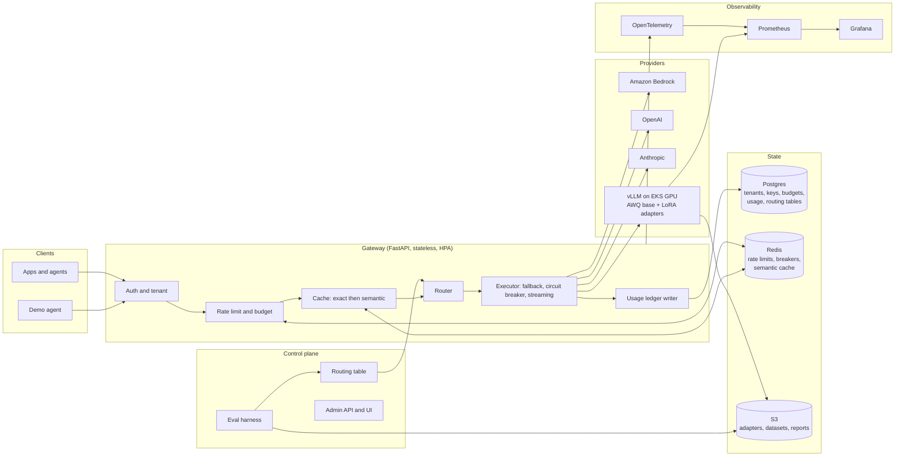
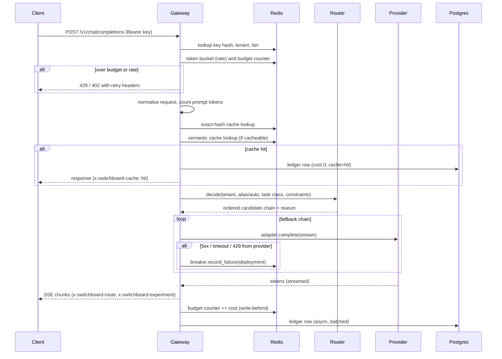

# Switchboard - LLM Inference and Routing Platform

Status: design v1 (2026-10-30)
Owner: Huru Algayeva

## 1. Purpose

Switchboard is the single API an organisation puts in front of all of its LLM traffic.
Every request is routed to the cheapest backend that satisfies the caller's quality,
latency and capability requirements, across managed providers (Amazon Bedrock, OpenAI,
Anthropic) and self-hosted open-weight models served by vLLM on GPU nodes in EKS.

It enforces per-tenant budgets, rate limits and access control, caches semantically,
records a cost ledger for every request, and ships an evaluation harness whose output
*is* the routing table. Routing decisions are therefore evidence-based and regression-gated
in CI, not hand-tuned.

### What it is not

- Not a chat UI, not a prompt-management tool, not a RAG framework.
- Not a general API gateway; it understands only LLM-shaped traffic.

### The one-paragraph explanation

"Designed and built a multi-tenant LLM gateway that routes requests across Bedrock, OpenAI
and self-hosted vLLM (AWQ-quantised, multi-LoRA) on EKS GPU spot nodes with scale-to-zero.
An eval harness scores every model per task class and generates the routing table; CI
fails on quality regression. Measured p99 gateway overhead of N ms, M tokens/s on a single
A10G, and X% cost reduction versus all-premium routing at equal eval quality."
(Fill N, M, X from the benchmark phase.)

## 2. Requirements

### Functional

| ID | Requirement |
|----|-------------|
| F1 | OpenAI-compatible `POST /v1/chat/completions` and `POST /v1/embeddings`, streaming (SSE) and non-streaming |
| F2 | Provider adapters: Bedrock Converse API, Anthropic Messages API, OpenAI-compatible HTTP (OpenAI, vLLM, llama.cpp) |
| F3 | Routing modes: explicit model id, alias (`fast`, `balanced`, `best`), and `auto` (task classifier + routing table) |
| F4 | Ordered fallback chains with per-deployment circuit breakers and a retry budget |
| F5 | Multi-tenancy: tenants, hashed API keys, roles (admin, developer, viewer), per-key rate limits |
| F6 | Monthly budgets per tenant with soft (warn header) and hard (HTTP 402) limits |
| F7 | Two-tier cache: exact-hash then semantic, per-tenant isolation, opt-out per request |
| F8 | Usage ledger: tokens in/out, USD cost, route decision and reason, latency, cache status, experiment id |
| F9 | Canary and A/B: weighted routing between deployments with experiment tagging in ledger and headers |
| F10 | Self-hosted tier: vLLM with AWQ base model and multiple LoRA adapters selected per request |
| F11 | Eval harness: scores every candidate model per task class, emits routing table, regression report, CI gate |
| F12 | Admin API: tenants, keys, budgets, usage summaries, routing table, experiments |

### Non-functional

| ID | Requirement | How it is verified |
|----|-------------|--------------------|
| N1 | Gateway overhead p99 under 15 ms excluding backend time | k6 against a stub backend |
| N2 | Gateway is stateless and horizontally scalable; all state in Postgres and Redis | HPA test under load |
| N3 | GPU tier scales to zero when idle; cold start to first token under 4 minutes | Measured with KEDA scale from 0 |
| N4 | Everything is infrastructure as code; one command creates and destroys the AWS environment | `terraform apply` and `destroy` in CI |
| N5 | Traces, metrics and logs correlated by request id | Grafana dashboards and Tempo traces |
| N6 | No plaintext secrets at rest, least-privilege IAM via IRSA, network policies between tiers | Checkov scan in CI |
| N7 | Unit, integration, contract tests against provider stubs; eval gate; load test pipeline | CI matrix |

## 3. System overview



## 4. Request lifecycle



Target per-stage overhead on the gateway: auth and limits under 2 ms (Redis pipeline),
cache under 3 ms exact / under 12 ms semantic (ONNX embedding on CPU), routing under 1 ms,
classifier under 5 ms. Everything else is backend time.

## 5. Components

### 5.1 Gateway service (`switchboard/`)

Python 3.12, FastAPI, uvicorn, Pydantic v2, httpx, asyncpg, redis-py.
One process type; concerns are separated by module, not by service:

```
switchboard/
  api/            OpenAI-compatible routes, admin routes, health
  auth/           API key hashing (SHA-256, ADR-0007), tenant resolution, RBAC
  limits/         token bucket rate limiting, budget enforcement
  cache/          exact hash tier, semantic tier, embedding model
  router/         policy engine, classifier, routing table loader, canary weights
  providers/      Adapter protocol + bedrock, anthropic, openai_compat adapters
  executor/       fallback chain, circuit breakers, retries, stream multiplexing
  ledger/         usage events, cost calculation, batched writer
  catalog/        model catalog (prices, capabilities, context windows)
  telemetry/      OpenTelemetry setup, Prometheus metrics, structured logging
  core/           settings, errors, request context
```

Request context carries `request_id`, `tenant_id`, `api_key_id`, `experiment_id`,
and is injected into every log line, span and ledger row.

### 5.2 Router (`switchboard/router/`)

Inputs form a `RouteRequest`:
tenant tier, requested model or alias or `auto`, predicted task class, prompt token count,
latency SLO (ms), max cost per request (USD), required capabilities (tools, JSON mode,
vision), region constraint.

Policy sources, in precedence order:

1. Tenant override (pin a tenant to a model or region).
2. Active experiment (weighted split between deployments, sticky by key hash).
3. Routing table (generated by the eval harness, versioned in Postgres, hot-reloadable).
4. Model catalog defaults.

Decision algorithm:

```
candidates = deployments that satisfy hard constraints (capabilities, context, region, healthy breaker)
for auto mode: filter to models whose eval quality[task_class] >= threshold[task_class]
sort by (cost per 1k tokens asc, p95 latency asc)
apply experiment weights if any
return ordered chain (max 3) with a human-readable reason
```

Task classifier: a small text classifier (logistic regression over bge-small embeddings
to start; fine-tuned DistilBERT if accuracy demands) with classes
`classification, extraction, summarisation, codegen, reasoning, chat, sql`.
Trained from the eval dataset labels. Runs on CPU in under 5 ms.

Resilience: each deployment has a circuit breaker in Redis (sliding window error rate,
half-open probes). Fallback is taken on 5xx, timeout, provider 429 and malformed stream.
A per-request retry budget caps total attempts at 3.

Explainability: every response carries `x-switchboard-route: <deployment>;reason=<...>`
and the ledger row stores the full decision.

### 5.3 Provider adapters (`switchboard/providers/`)

```python
class ProviderAdapter(Protocol):
    async def complete(self, req: ChatRequest, deployment: Deployment) -> ChatResponse: ...
    def stream(self, req: ChatRequest, deployment: Deployment) -> AsyncIterator[ChatChunk]: ...
    async def embed(self, req: EmbedRequest, deployment: Deployment) -> EmbedResponse: ...
    def count_tokens(self, req: ChatRequest, deployment: Deployment) -> int: ...
```

- `openai_compat`: OpenAI, vLLM, llama.cpp. Same wire format; differences handled by deployment flags.
- `anthropic`: Messages API, system prompt and tool-call translation.
- `bedrock`: Converse and ConverseStream via aioboto3, IRSA credentials, region per deployment.

Adapters never see tenants or budgets. They translate and stream, nothing else.
See ADR-0001 for why these are hand-written rather than wrapping LiteLLM.

### 5.4 Model catalog (`catalog/models.yaml`)

One entry per deployment: id, provider, endpoint, region, price in/out per 1M tokens,
context window, capabilities, max concurrency, default timeouts. Prices live here so cost
is computed at request time and never needs a provider billing export.

### 5.5 Self-hosted inference tier (`deploy/vllm/`)

- Base model: `Qwen/Qwen2.5-7B-Instruct-AWQ` (fits an A10G 24 GB with room for KV cache and adapters).
  Fallback option: `Llama-3.1-8B-Instruct` AWQ.
- vLLM flags: `--quantization awq --enable-lora --max-loras 4 --max-lora-rank 64
  --max-model-len 8192 --gpu-memory-utilization 0.90 --enable-prefix-caching`.
- LoRA adapters live in S3; an init container syncs the adapter manifest to a local
  volume; `--lora-modules` is rendered from a ConfigMap. A request selects an adapter by
  model id (`qwen2.5-7b:fin-extract`).
- Node: `g5.xlarge` (1x A10G) spot via Karpenter, on-demand fallback, GPU taint.
- Scaling: KEDA ScaledObject on Prometheus `vllm:num_requests_waiting` and gateway queue
  depth, min 0, max 2. Scale-to-zero after 10 minutes idle. Cold start budget: 4 minutes
  (node provision, image pull from ECR with a pre-baked model layer, model load).
- Model weights baked into the image layer or an EBS snapshot (decide in phase 5 by
  measured cold start; ADR to follow).
- Local development: `llama.cpp` server with a 1.5B Q4_K_M GGUF model behind the same
  `openai_compat` adapter, so every gateway feature works offline on CPU.

### 5.6 Cache (`switchboard/cache/`)

Tier 1, exact: SHA-256 of (tenant, model class, normalised messages, sampling params).
Tier 2, semantic: `bge-small-en-v1.5` via ONNX Runtime on CPU, cosine threshold 0.95,
Redis vector index (RediSearch), namespace per tenant and model class, TTL 24 h.
Only requests with `temperature <= 0.2`, no tools, and `cache: true` (default) are eligible.
Hits write a ledger row with zero cost and `cache=semantic`, so cache savings are
reported in USD, not guessed.

### 5.7 Data model (Postgres 16)

```
tenants(id, name, tier, created_at)
api_keys(id, tenant_id, key_hash, role, rate_limit_rpm, rate_limit_tpm, revoked_at)
budgets(tenant_id, month, soft_usd, hard_usd)
usage_events(id, ts, tenant_id, api_key_id, request_id, deployment_id, task_class,
             route_mode, route_reason, experiment_id, cache_status,
             prompt_tokens, completion_tokens, cost_usd,
             ttft_ms, total_ms, status)            -- partitioned by month
routing_tables(id, version, generated_by_eval_run, table_json, active)
experiments(id, name, weights_json, started_at, ended_at)
eval_runs(id, dataset_version, started_at, results_json, report_uri)
```

Redis holds rate-limit buckets, breaker state, budget counters (write-behind to Postgres
every 5 s) and the semantic cache.

### 5.8 Eval harness (`evals/`)

- Dataset: 300 to 500 prompts with references, labelled by task class, versioned in S3.
  Sources: subsets of public sets (Spider for SQL, XSum for summarisation, a GSM8K slice
  for reasoning, HumanEval slice for code) plus a hand-built financial extraction set.
- Scorers: exact match and F1 (extraction, classification), execution accuracy (SQL,
  against SQLite), pass@1 (code, sandboxed), rubric LLM-as-judge with a strong model
  (summarisation, reasoning, chat) with judge agreement checked on a 50-item human sample.
- Output per run: quality matrix (model x task), cost matrix, latency matrix,
  a proposed routing table (cheapest model per task above its threshold), and a
  Markdown report diffed against the previous run.
- CI: nightly run plus on every PR that touches `catalog/` or `evals/`. The gate fails if
  the chosen model for any task class drops more than 2 points or if a cheaper model now
  passes (which means the table is stale).

### 5.9 Fine-tuning track (`finetune/`)

Task: structured extraction from financial statements into a fixed JSON schema
(ties directly to the banking and KPMG background). LoRA on Qwen2.5-7B with Unsloth,
evaluated by the same harness, pushed to S3 as an adapter, and the routing table sends
`extraction` traffic to it. Headline target: quality parity with the premium model on
the extraction task at a fraction of the cost per request. The exact fraction is measured.

### 5.10 Observability (`switchboard/telemetry/`, `deploy/observability/`)

Spans: `gateway.request`, `auth`, `limits`, `cache.lookup`, `router.decide`,
`provider.call`, `stream.first_token`, `ledger.write`.
Metrics (Prometheus):

```
switchboard_requests_total{tenant,deployment,status,cache,route_mode}
switchboard_request_duration_seconds{deployment}      histogram
switchboard_ttft_seconds{deployment}                  histogram
switchboard_gateway_overhead_seconds                  histogram
switchboard_tokens_total{tenant,deployment,direction}
switchboard_cost_usd_total{tenant,deployment}
switchboard_cache_hits_total{tier}
switchboard_breaker_state{deployment}
switchboard_budget_used_ratio{tenant}
vllm:*                                                scraped from vLLM
```

Grafana dashboards as JSON in the repo: Traffic and latency, Cost and budgets,
GPU tier, Cache and routing. Alerts: error rate, p99, budget at 80 percent, GPU queue depth,
breaker open longer than 5 minutes. Logs are structured JSON shipped by Fluent Bit to
CloudWatch (Loki locally).

### 5.11 Admin API and UI

FastAPI routes under `/admin` guarded by the `admin` role. A small React (Vite +
TypeScript) dashboard: tenants and keys, usage by tenant and model, active routing table
with eval evidence, experiments. Stretch goal, last phase; Grafana covers the essentials.

### 5.12 Demo consumer agent (`examples/analyst_agent/`)

A LangGraph agent that analyses an uploaded financial report in three steps and calls the
gateway with a different alias for each: classify (`fast`), extract (`auto`, which lands on
the LoRA adapter), synthesise (`best`). It prints the ledger for the run next to the same
run forced to `best` everywhere. This is the cost-reduction number for the README.

## 6. Infrastructure

### 6.1 Environments

| Env | Where | Purpose |
|-----|-------|---------|
| local | Docker Compose (Postgres, Redis Stack, llama.cpp, Prometheus, Grafana, Tempo) | Daily development, all tests |
| kind | kind cluster with the same Helm chart, no GPU | Chart, KEDA and network policy tests |
| aws | EKS, one ephemeral environment | GPU serving, benchmarks, screenshots, then destroyed |

### 6.2 Terraform layout (`infra/terraform/`)

```
modules/
  network        VPC, 2 AZ, private subnets, NAT (single, cost)
  eks            cluster, managed node group (system, 2x t3.medium), IRSA, add-ons
  karpenter      controller, GPU NodePool (g5 spot then on-demand), consolidation
  platform       KEDA, metrics-server, AWS Load Balancer Controller, external-secrets,
                 kube-prometheus-stack, Fluent Bit
  data           RDS Postgres 16 (db.t4g.micro), ElastiCache Redis 7 (cache.t4g.micro)
  storage        S3: adapters, datasets, eval-reports (versioned, lifecycle rules)
  registry       ECR repositories with scan-on-push
  secrets        Secrets Manager entries, IRSA role bindings
  iam            gateway role (bedrock:InvokeModel*, s3 read), vllm role (s3 read)
envs/
  aws-dev        composes the modules; remote state in S3 with DynamoDB lock
```

Helm chart `deploy/helm/switchboard` deploys gateway (HPA on CPU and RPS), vLLM
(KEDA-scaled), ConfigMaps for catalog and routing table, NetworkPolicies, ServiceMonitors.

### 6.3 CI/CD (GitHub Actions)

```
ci.yml        ruff, mypy, pytest (unit + integration with testcontainers), coverage floor 85
evals.yml     nightly and on catalog/evals changes; uploads report; gate
image.yml     build and push gateway and vllm images to ECR, SBOM, Trivy scan
infra.yml     terraform fmt, validate, plan on PR; apply on manual dispatch; checkov
deploy.yml    helm upgrade to aws-dev on tag; canary weight bump via admin API
load.yml      k6 run on manual dispatch, publishes benchmark Markdown
```

### 6.4 Cost plan

AWS is used in short bursts. Build and test everything locally; create the AWS
environment only for serving tests, benchmarks and screenshots, then destroy it.

| Item | Approx. hourly | Note |
|------|----------------|------|
| EKS control plane | 0.10 USD | Fixed while the cluster exists |
| 2x t3.medium system nodes | 0.08 USD | |
| g5.xlarge spot | 0.35 to 0.45 USD | Scales to zero when idle |
| RDS db.t4g.micro + ElastiCache t4g.micro | 0.03 USD | |
| NAT gateway | 0.045 USD + data | Single AZ to save cost |
| Bedrock / OpenAI eval calls | 5 to 15 USD per full eval run | Use small slices while iterating |

Budget for the whole project: roughly 60 to 120 USD if the cluster lives for 3 to 4
sessions of 4 to 6 hours each. Set an AWS Budget alert at 50 USD and 100 USD on day one.

## 7. Security

- API keys are random 32-byte tokens shown once; only a SHA-256 hash is stored (ADR-0007).
- Secrets come from AWS Secrets Manager through external-secrets; nothing in Helm values.
- IRSA roles per workload; the gateway can invoke Bedrock and read S3, nothing else.
- NetworkPolicies: only the gateway can reach vLLM; vLLM has no egress except S3.
- Images are scanned (Trivy) and run as non-root with read-only filesystems.
- Per-tenant isolation in cache keys and ledger queries; tenant id comes from the key,
  never from the request body.
- Prompt and completion bodies are not logged by default; a per-tenant flag enables
  sampled logging for debugging.

## 8. Testing strategy

| Layer | Tool | What it proves |
|-------|------|----------------|
| Unit | pytest, hypothesis | Router decisions, cost maths, token counting, cache key normalisation |
| Contract | pytest + recorded fixtures per provider | Adapter translation and streaming parsing stay correct |
| Integration | testcontainers (Postgres, Redis), stub provider | Full request lifecycle, budgets, breakers, fallback |
| Chart | kind + helm test | Deployability, NetworkPolicies, KEDA objects |
| Eval | evals harness in CI | Routing table quality, regression gate |
| Load | k6 | Overhead p99, throughput, scale-from-zero timing |
| Mutation | mutmut on router and limits packages | Tests actually catch logic errors |

## 9. Repository layout

```
switchboard/
  switchboard/          service code (see 5.1)
  catalog/              models.yaml, routing-table.json (generated)
  evals/                datasets, scorers, runner, reports
  finetune/             LoRA training scripts and adapter manifest
  deploy/
    helm/switchboard/
    vllm/               Dockerfile, adapter sync, manifest
    observability/      dashboards, alert rules, otel collector config
    compose/            docker-compose.yml for local
  infra/terraform/
  examples/analyst_agent/
  ui/                   admin dashboard (stretch)
  load/                 k6 scripts
  docs/
    ARCHITECTURE.md, PLAN.md, adr/, benchmarks/
  .github/workflows/
```

## 10. Decisions

See `docs/adr/`. Key ones:

- ADR-0001 hand-written provider adapters, not a LiteLLM wrapper
- ADR-0002 vLLM for the self-hosted tier
- ADR-0003 Postgres and Redis only, no message broker
- ADR-0004 Terraform, Helm and GitHub Actions
- ADR-0005 the eval harness generates the routing table
- ADR-0006 semantic cache in Redis with a CPU ONNX embedding model

## 11. Risks and mitigations

| Risk | Mitigation |
|------|------------|
| GPU spot interruption mid-benchmark | On-demand fallback in the NodePool; benchmarks are rerunnable scripts |
| Cold start exceeds 4 minutes | Bake weights into the image; measure; fall back to EBS snapshot |
| LLM judge disagrees with humans | 50-item human-labelled calibration set, report agreement |
| Scope creep (UI, more providers) | UI is last and optional; three adapters only |
| AWS cost overrun | Budget alerts, ephemeral env, destroy at the end of every session |
| Python 3.14 on the dev machine | `uv python install 3.12`; project pinned to 3.12 |
